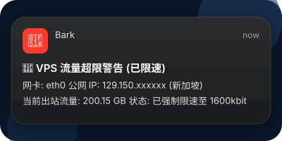
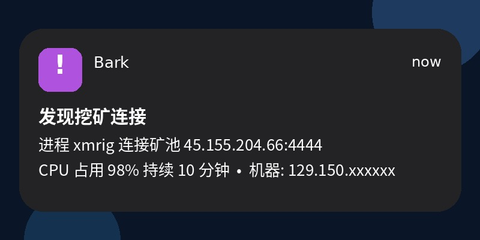
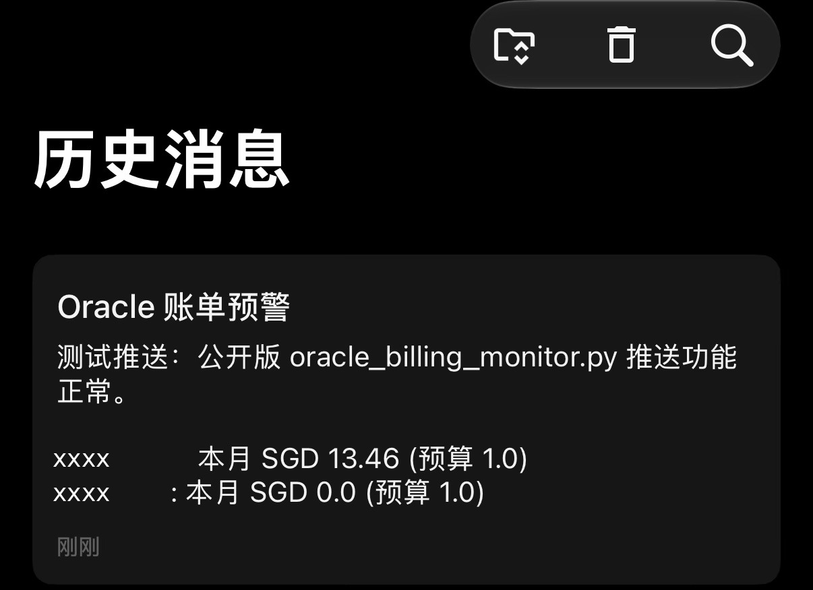
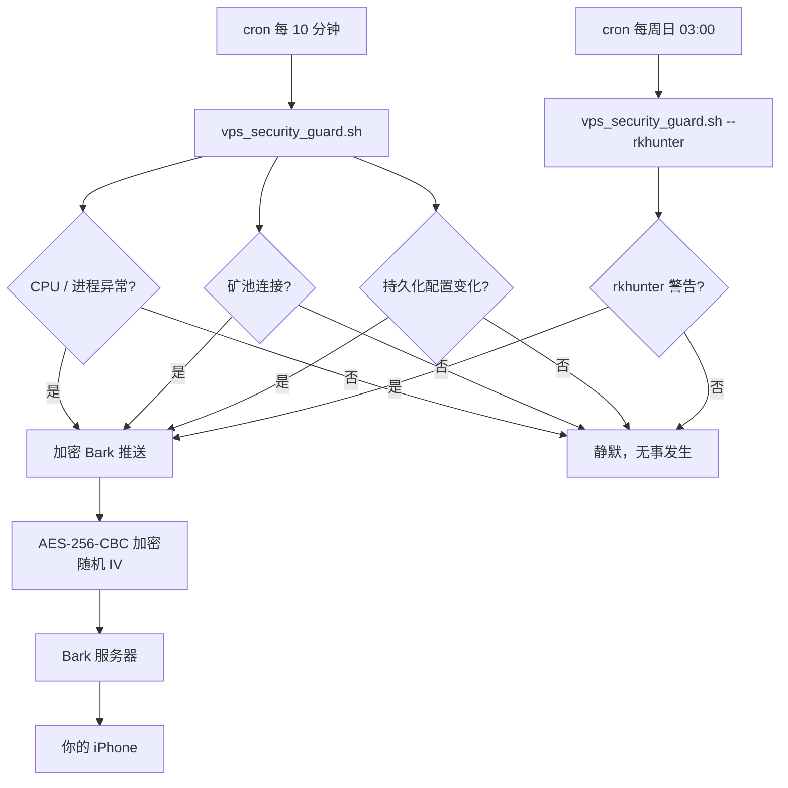

# 🔔 VPS 卫士：流量监控、防挖矿、Oracle 账单预警

[English](README_EN.md) | 中文

轻量级 VPS 安全监控脚本：**流量监控 + 防挖矿 + 持久化检测 + rootkit 扫描 + Oracle 账单监控**，异常时通过**加密 Bark 推送**第一时间通知到你的 iPhone。

> 部署在 6 台生产 VPS 上实测运行，单核 1GB 小鸡也能轻松带动。

## 📱 报警效果

| 流量超限 | 挖矿检测 | Oracle 账单（实拍） |
|----------|----------|---------------------|
|  |  |  |

## ✨ 功能

| 检查 | 说明 | 触发条件 |
|------|------|----------|
| **流量监控** | 防超流量 | 出站流量达到 10GB / 20GB 时提醒，达到 200GB 时按 `OVER_LIMIT_MODE` 处理：0=阻断断网（iptables 熔断，SSH 逃生门保留），1=限速到 200KB/s 不断网（阈值都在脚本顶部，改数字就能用） |
| **CPU / 进程异常** | 防挖矿 | 单个非白名单进程 CPU > 50% 持续 10 分钟，或 1 分钟负载 > 2×核数持续 10 分钟 |
| **挖矿连接** | 防挖矿 | 发现到矿池端口（3333 / 4444 / 5555 / 7777 / 9999 / 14433 / 14444 / 45700 等）的出站连接 |
| **持久化基线** | 防入侵 | crontab、`/etc/cron.d`、systemd 启用服务、`authorized_keys` 发生变化 |
| **rkhunter** | 防 rootkit | 每周扫描，有警告则推送（已内置常见误报白名单） |
| **Oracle 账单监控** | 防超支 | 每天检查 Oracle Cloud 账单，超预算报警，自动停掉付费实例（只停不停删） |

**报警去重**：同一问题只报一次，恢复后会推送"已恢复正常"，不会刷屏。

**容器适配**：LXC / Docker 等容器里 `/proc/loadavg` 反映的是宿主机负载（内核不隔离 loadavg），脚本会自动检测容器环境并跳过负载检查，避免误报。单进程 CPU 检查用 `ps`（容器内可见），不受影响。

**加密推送**：所有报警内容在本地用 AES-256-CBC 加密（每次随机 IV），只有你的 Bark App 能解密，即使推送经过第三方服务器也不会泄露服务器信息。

## 📊 流量监控说明（auto_limit.sh）

### 阈值配置（都在脚本顶部，改数字就能用）

| 配置项 | 默认值 | 说明 |
|--------|--------|------|
| `LIMIT_10GB` | 10 | 出站流量到 10GB 时推送一次提醒（只提醒，不限速） |
| `LIMIT_20GB` | 20 | 出站流量到 20GB 时推送一次提醒（只提醒，不限速） |
| `LIMIT_GB` | 200 | 出站流量到 200GB 时触发超限处理（按 `OVER_LIMIT_MODE` 执行） |
| `RATE_LIMIT` | 1600kbit | 限速目标，约 200 KB/s（仅限速模式生效） |
| `OVER_LIMIT_MODE` | 1 | **超限处理模式：0 = 阻断断网（iptables 熔断，SSH 逃生门保留），1 = 限速不断网（tc 限流）** |
| `SSH_PORT` | 自动识别 | SSH 逃生端口（仅阻断模式生效）：自动检测 sshd 实际监听的端口，不用手动改；如需手动指定，取消 `SSH_PORT_OVERRIDE` 的注释 |

想改成 5GB 提醒、50GB 提醒，直接把 `LIMIT_10GB` 改成 5、`LIMIT_20GB` 改成 50 就行。

### 网卡自动识别

脚本优先从默认路由获取网卡名（最准确），如果获取失败，按常见网卡名依次尝试。已覆盖的主流云厂商网卡：

| 网卡名 | 适用云厂商 |
|--------|-----------|
| `eth0` | AWS（Xen）、Azure、DigitalOcean、IBM Cloud、阿里云、Akamai（Linode）、OVHcloud、Vultr、Hetzner、华为云、Exoscale、Scaleway、Gcore、Contabo、腾讯云、IONOS |
| `ens3` | Oracle Cloud、OVHcloud、Vultr、Hetzner Cloud、华为云、Exoscale、Scaleway、Gcore、Contabo、IONOS |
| `ens5` | AWS Nitro（ENA）、阿里云新机型、腾讯云新机型 |
| `ens4` | Google Cloud |
| `enp0s3` | Oracle 部分机型、KVM 通用 |
| `enp1s0` | Vultr 新机型、Hetzner 独服、Scaleway |
| `eno1` | OVH 独服、Hetzner 独服 |
| `ens6` | AWS 部分 Nitro 机型 |
| `venet0` | OpenVZ 容器（Contabo 老款等） |
| `eth1` | 各厂商私网/内网网卡（备用） |
| `enP1s1` | Azure 部分可预测命名 |

全部失败则退出并写日志，不会误操作。注：Backblaze B2 是纯对象存储，没有服务器/网卡，不适用本脚本。

### 限速 ≠ 断网

触发限速后，服务器只是变慢（默认 200 KB/s），**SSH 照常能连，不会把自己锁在外面**。想恢复全速，执行：

```bash
tc qdisc del dev <网卡名> root
```

### 流量统计说明

- 只统计**出站流量**（tx_bytes），入站不计。
- 统计值来自网卡启动以来的累计值，**服务器重启后清零**。如果你的 VPS 按自然月计费，每月 1 号重启一次服务器即可对齐（或手动重置统计）。

## 🐕 流量终极看门狗（oracle_traffic_guard.py）

`auto_limit.sh` 的 Python 升级版：vnstat 按自然月统计（重启不清零）+ IP 与地理位置解析 + 阶梯预警 + **超限处理二选一**。

### 超限模式自由选择（改一个数字就行）

| `OVER_LIMIT_MODE` | 模式 | 超限后会发生什么 | 适合谁 |
|---|---|---|---|
| `0`（默认） | **阻断断网** | iptables 熔断：切断外网出站，SSH 逃生门与内网保留 | 怕超额扣费，宁可断网也要保住钱包 |
| `1` | **限速不断网** | tc 限流到 `RATE_LIMIT`（默认约 200KB/s），SSH 与服务都不掉线 | 怕断网影响服务，宁可变慢也不断连 |

```python
# ★★★ 流量阈值配置（都在这里，改数字就能用）★★★
OVER_LIMIT_MODE = 0        # 0 是阻断，1 是限流
MONTHLY_LIMIT_GB = 200.0   # 月流量硬顶，到量触发超限处理
RATE_LIMIT = "1600kbit"    # 限速模式下的速率（仅模式 1 生效）
```

### 与 auto_limit.sh 的区别

| | auto_limit.sh | oracle_traffic_guard.py |
|---|---|---|
| 流量统计 | 网卡累计值（重启清零） | vnstat 按自然月（重启不清零） |
| 超限处理 | 只有 tc 限速 | 阻断 / 限速二选一 |
| 阶梯预警 | 2 档（10GB / 20GB） | 4 档（5 / 20 / 50 / 100GB） |
| 推送内容 | IP + 流量 | IP + 地理位置 + 流量 |
| 适用场景 | 通用 VPS | 甲骨文云（按月计费）优先 |

### 常用命令

```bash
python3 oracle_traffic_guard.py status   # 查看当前流量、模式与超限状态
python3 oracle_traffic_guard.py test     # 发一条测试推送到手机
python3 oracle_traffic_guard.py trip     # 手动触发超限处理（按配置的模式）
python3 oracle_traffic_guard.py reset    # 解除熔断与限速（两种状态都清掉）
```

### 安装

```bash
apt-get update && apt-get install -y vnstat python3 curl
systemctl enable --now vnstat
cp oracle_traffic_guard.py /usr/local/bin/
chmod +x /usr/local/bin/oracle_traffic_guard.py
# 改好顶部的 BARK_KEY、BARK_ENC_KEY、OVER_LIMIT_MODE 后加入 cron：
# */10 * * * * /usr/bin/python3 /usr/local/bin/oracle_traffic_guard.py check
```

## ☁️ Oracle Cloud 账单监控（oracle_billing_monitor.py）

每天早上检查 Oracle Cloud 账单，防止误开付费实例悄悄扣费：

- **费用检查**：用 OCI Usage API 查本月已花多少，对比预算（默认 SGD 1.00），超支就报警
- **新增费用提醒**：跟上次检查对比，本月费用有新增就告诉你多了多少
- **自动停机**：发现运行中的付费规格实例（如 E5/E4/E3 Flex），自动 STOP（只停不停删，随时能再开）。Always Free 规格（A1.Flex、E2.1.Micro）和保护名单里的服务器永远不会被停
- **免费额度检查**：A1 超过 4 OCPU / 24GB、E2.1.Micro 超过 2 台时提醒，超出部分会收费
- **多账号**：支持多个 Oracle 账号（每个账号一个 OCI profile）

有报警或检查失败时，用加密 Bark 推送到手机；没事就静默，只在 stdout 输出 JSON 报告。

### 配置

```bash
pip install oci
```

1. 在 Oracle 控制台生成 API 密钥对，把公钥加到账号（用户设置 → API Keys），按 [OCI 官方文档](https://docs.oracle.com/en-us/iaas/Content/API/Concepts/sdkconfig.htm)写好 `~/.oci/config`（每个账号一个 profile）
2. 打开脚本顶部配置区，填你的 profile 和账号名、预算、保护名单（重要服务器的显示名）
3. （可选）Bark 推送：把 Bark 推送 URL 存到脚本同目录的 `bark_url` 文件、32 位加密 Key 存到 `bark_key` 文件，`chmod 600`。没有这两个文件时脚本照常运行，只是不发推送
4. 加到 cron，每天早上跑一次：

```cron
15 8 * * * /usr/bin/python3 /path/to/oracle_billing_monitor.py
```

## 🏗️ 工作原理



## 🚀 快速开始

### 1. 准备工作

- 一台 Debian / Ubuntu 服务器（root 权限）
- iPhone 上安装 [Bark App](https://apps.apple.com/app/bark/id1403753865)
- 在 Bark App 里开启加密：设置 → 加密 → 算法 AES256、模式 CBC、填充 pkcs7，并设置一个 32 位 Key

### 2. 安装

```bash
# 下载安全监控脚本
curl -sSL -o /usr/local/bin/vps_security_guard.sh \
  https://raw.githubusercontent.com/jimu2000/vps-traffic-guard/main/vps_security_guard.sh
chmod +x /usr/local/bin/vps_security_guard.sh

# 下载流量卫士脚本
curl -sSL -o /root/auto_limit.sh \
  https://raw.githubusercontent.com/jimu2000/vps-traffic-guard/main/auto_limit.sh
chmod +x /root/auto_limit.sh

# 安装 rkhunter（用于每周 rootkit 扫描）
apt update && apt install -y rkhunter
rkhunter --propupd   # 建立文件属性基线
```

### 3. 配置

打开脚本，把顶部的两处 `xxxxxxxxx` 改成你自己的：

```bash
# Bark 设备 Key（在 Bark App 首页查看）
BARK_DEVICE_KEY="xxxxxxxxx"
```

然后生成加密 Key 文件（必须和 Bark App 里设置的 Key 一致）：

```bash
# 方法一：用你自己想好的 32 位 Key
echo -n "你的32位Key" > /root/.bark_enc_key
chmod 600 /root/.bark_enc_key

# 方法二：随机生成一个
head -c 32 /dev/urandom | base64 | head -c 32 > /root/.bark_enc_key
chmod 600 /root/.bark_enc_key
cat /root/.bark_enc_key   # 把显示的 Key 填到 Bark App 的加密设置里
```

### 4. 消除 rkhunter 误报（推荐）

rkhunter 默认配置在大多数 VPS 上会报两条误报，建议先加上白名单：

```bash
# 如果你的服务器允许 root 登录（大多数 VPS 默认如此）
echo "ALLOW_SSH_ROOT_USER=yes" >> /etc/rkhunter.conf

# /etc/.updated 是 systemd 的合法时间戳文件
echo "ALLOWHIDDENFILE=/etc/.updated" >> /etc/rkhunter.conf

# 如果是 LXC 容器（如 EUserv 免费 vServer），再加这两行：
echo "ALLOWHIDDENFILE=/dev/.lxc-boot-id" >> /etc/rkhunter.conf
echo "ALLOWHIDDENDIR=/dev/.lxd-mounts" >> /etc/rkhunter.conf
```

### 5. 加入 cron

```bash
crontab -e
```

添加以下三行：

```cron
# 每 10 分钟常规检查（CPU / 挖矿连接 / 持久化）
*/10 * * * * /usr/local/bin/vps_security_guard.sh >> /var/log/vps_security_guard.log 2>&1

# 每 10 分钟流量检查（流量卫士）
*/10 * * * * /bin/bash /root/auto_limit.sh

# 每周日凌晨 3 点 rkhunter 扫描
0 3 * * 0 /usr/local/bin/vps_security_guard.sh --rkhunter >> /var/log/vps_security_guard_rkhunter.log 2>&1
```

### 6. 测试

```bash
/usr/local/bin/vps_security_guard.sh --test
```

手机上收到"安全监控测试"推送，说明部署成功。如果收到的是乱码，检查加密 Key 是否和 App 里设置的一致。

## 📁 文件说明

| 文件 | 说明 |
|------|------|
| `auto_limit.sh` | 流量卫士：出站流量监控 + 超限自动限速（阈值在脚本顶部） |
| `oracle_traffic_guard.py` | 流量终极看门狗：vnstat 月统计 + 阶梯预警 + 超限阻断/限速二选一 |
| `vps_security_guard.sh` | 主监控脚本（CPU / 挖矿 / 持久化 / rkhunter） |
| `bark_enc.sh` | 独立的 Bark 加密推送脚本，可在其他脚本里调用 |
| `oracle_billing_monitor.py` | Oracle Cloud 账单监控：每天检查费用，超预算报警，自动停掉付费实例（需 `pip install oci`） |

### bark_enc.sh 单独使用

```bash
# 直接推送
./bark_enc.sh "标题" "内容" "alarm"

# 在其他脚本里引用
source /path/to/bark_enc.sh
bark_enc "服务器报警" "CPU 使用率 95%" "alarm"
```

## ⚙️ 自定义

**CPU 白名单**：脚本内置了常见系统进程白名单（xray、nginx、crowdsec、fail2ban 等）。如果你的服务器上有其他常驻高 CPU 进程，在 `check_cpu` 函数的 `case` 白名单里加上进程名即可。

**矿池端口**：在 `check_mining` 函数里修改 `ports` 变量。

**报警冷却**：默认同一问题 12 小时内只报一次（挖矿连接和持久化变化为 24 小时），在各检查函数里修改 `should_alert` 的第二个参数。

**基线重置**：如果你自己改了 crontab 或 systemd 服务，监控会报警一次确认。确认无误后，删除对应的基线文件即可（下次检查会自动重建）：

```bash
rm /root/.security_baseline/crontab.txt /root/.security_baseline/systemd.txt
```

## ❓ 常见问题

**Q: 收到"持久化配置变化"报警，是被入侵了吗？**
A: 先看变化内容。刚部署时，监控自身的 cron 任务加入会导致一次报警，这是正常的。平时如果你自己改了 crontab、装了新服务，也会报警。确认是你自己改的就好；如果不是你改的，再进一步检查。

**Q: 收到"系统负载异常"，是被挖矿了吗？**
A: 先看当时的进程。rkhunter 扫描、系统更新、备份等任务都会短暂拉高负载。登录服务器用 `top` 看看是哪个进程在占 CPU，再判断。

**Q: 为什么不用 ClamAV 做病毒扫描？**
A: ClamAV 内存占用大（1GB 以上），小内存 VPS 跑不动，而且代理服务器上不存用户文件，病毒扫描价值有限。rkhunter + 持久化检测已经能覆盖主要的入侵场景。

**Q: 支持哪些系统？**
A: Debian / Ubuntu（使用 systemd 和 cron）。其他 Linux 发行版可能需要调整个别命令。

## 📄 许可证

MIT License — 随便用，改了也不用告诉我。

## 🙏 致谢

- [Bark](https://github.com/Finb/Bark) — 优雅的 iOS 推送服务
- [rkhunter](http://rkhunter.sourceforge.net/) — Rootkit Hunter
