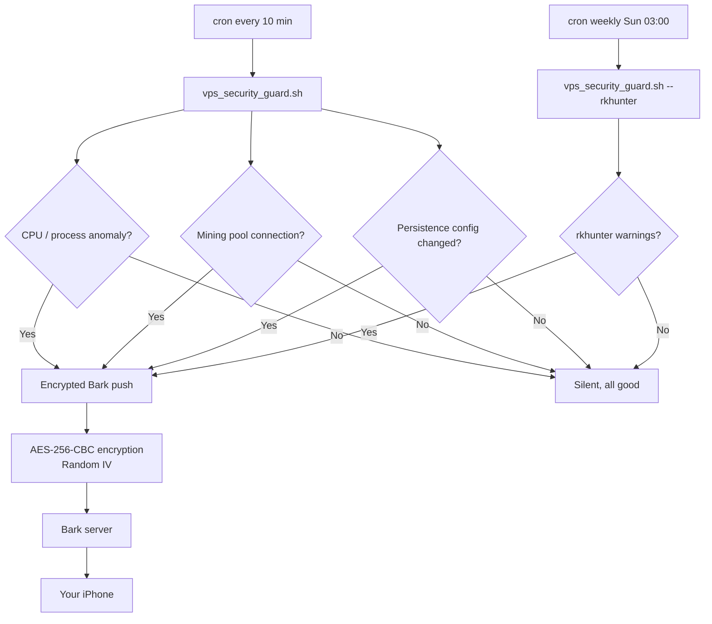

# 🔔 VPS Traffic Guard & Mining Detection

[中文](README.md) | English

A lightweight VPS security monitoring script: **traffic monitoring + anti-mining + persistence detection + rootkit scanning** — with **end-to-end encrypted Bark push notifications** to your iPhone when something goes wrong.

> Battle-tested on 6 production VPS instances. Runs fine even on a 1-core, 1GB box.

## ✨ Features

| Check | Purpose | Trigger |
|-------|---------|---------|
| **Traffic monitoring** | Anti-overage | Outbound traffic hits 10GB / 20GB → reminder; hits 200GB → auto speed-limit to 200KB/s (all thresholds at the top of the script, just change the numbers) |
| **CPU / process anomaly** | Anti-mining | A non-whitelisted process uses > 50% CPU for 10+ minutes, or 1-min load > 2× CPU cores for 10+ minutes |
| **Mining connections** | Anti-mining | Outbound connection to a known mining pool port (3333 / 4444 / 5555 / 7777 / 9999 / 14433 / 14444 / 45700, etc.) |
| **Persistence baseline** | Anti-intrusion | Changes to crontab, `/etc/cron.d`, enabled systemd services, or `authorized_keys` |
| **rkhunter** | Anti-rootkit | Weekly scan; alerts on warnings (common false positives pre-whitelisted) |

**Alert deduplication**: The same issue alerts only once. You'll get a "back to normal" notification when it recovers — no spam.

**Container-aware**: In LXC / Docker containers, `/proc/loadavg` reflects the host's load (the kernel doesn't isolate loadavg), so the script auto-detects container environments and skips the load check to avoid false positives. Per-process CPU checks use `ps` (visible inside containers) and are unaffected.

**Encrypted push**: Every alert is encrypted locally with AES-256-CBC (fresh random IV each time). Only your Bark app can decrypt it, so server details never leak through the push provider.

## 📊 Traffic Monitoring (auto_limit.sh)

### Thresholds (all at the top of the script, just change the numbers)

| Setting | Default | Description |
|---------|---------|-------------|
| `LIMIT_10GB` | 10 | Push a reminder when outbound traffic reaches 10GB (reminder only, no throttling) |
| `LIMIT_20GB` | 20 | Push a reminder when outbound traffic reaches 20GB (reminder only, no throttling) |
| `LIMIT_GB` | 200 | Auto speed-limit + push an alert when outbound traffic reaches 200GB |
| `RATE_LIMIT` | 1600kbit | Speed limit target, ≈ 200 KB/s |

To get reminders at 5GB and 50GB instead, just change `LIMIT_10GB` to 5 and `LIMIT_20GB` to 50.

### Automatic NIC detection

The script first reads the NIC from the default route (most accurate). If that fails, it tries common NIC names in order. Covered cloud providers:

| NIC | Cloud providers |
|-----|----------------|
| `eth0` | AWS (Xen), Azure, DigitalOcean, IBM Cloud, Alibaba Cloud, Linode, OVHcloud, Vultr, Hetzner, Huawei Cloud, Exoscale, Scaleway, Gcore, Contabo, Tencent Cloud, IONOS |
| `ens3` | Oracle Cloud, OVHcloud, Vultr, Hetzner Cloud, Huawei Cloud, Exoscale, Scaleway, Gcore, Contabo, IONOS |
| `ens5` | AWS Nitro (ENA), Alibaba Cloud (newer), Tencent Cloud (newer) |
| `ens4` | Google Cloud |
| `enp0s3` | Oracle (some shapes), KVM generic |
| `enp1s0` | Vultr (newer), Hetzner dedicated, Scaleway |
| `eno1` | OVH dedicated, Hetzner dedicated |
| `ens6` | AWS (some Nitro shapes) |
| `venet0` | OpenVZ containers (older Contabo, etc.) |
| `eth1` | Private/VPC NIC on most providers (fallback) |
| `enP1s1` | Azure (some predictable names) |

If none works, it exits and logs the failure — no incorrect actions. Note: Backblaze B2 is object storage only (no server/NIC), so this script doesn't apply to it.

### Speed limit ≠ disconnection

When the limit triggers, the server just gets slower (default 200 KB/s). **SSH still works — you won't lock yourself out.** To restore full speed:

```bash
tc qdisc del dev <interface> root
```

### Traffic counting notes

- Only **outbound traffic** (tx_bytes) is counted; inbound is ignored.
- The counter is cumulative since the NIC came up and **resets on reboot**. If your VPS bills monthly, reboot on the 1st of each month to align (or reset the counter manually).

## 🏗️ How It Works



## 🚀 Quick Start

### 1. Prerequisites

- A Debian / Ubuntu server (root access)
- [Bark app](https://apps.apple.com/app/bark/id1403753865) on your iPhone
- Encryption enabled in Bark: Settings → Encryption → AES256 / CBC / pkcs7, with a 32-character key

### 2. Install

```bash
# Download the security monitor script
curl -sSL -o /usr/local/bin/vps_security_guard.sh \
  https://raw.githubusercontent.com/jimu2000/vps-traffic-guard/main/vps_security_guard.sh
chmod +x /usr/local/bin/vps_security_guard.sh

# Download the traffic guard script
curl -sSL -o /root/auto_limit.sh \
  https://raw.githubusercontent.com/jimu2000/vps-traffic-guard/main/auto_limit.sh
chmod +x /root/auto_limit.sh

# Install rkhunter (for weekly rootkit scans)
apt update && apt install -y rkhunter
rkhunter --propupd   # Build the file-properties baseline
```

### 3. Configure

Edit the top of the script and replace the two `xxxxxxxxx` placeholders:

```bash
# Bark device key (shown on the Bark app home screen)
BARK_DEVICE_KEY="xxxxxxxxx"
```

Then create the encryption key file (must match the key in your Bark app):

```bash
# Option 1: Use your own 32-character key
echo -n "your-32-character-key-here" > /root/.bark_enc_key
chmod 600 /root/.bark_enc_key

# Option 2: Generate a random one
head -c 32 /dev/urandom | base64 | head -c 32 > /root/.bark_enc_key
chmod 600 /root/.bark_enc_key
cat /root/.bark_enc_key   # Paste this key into Bark's encryption settings
```

### 4. Silence rkhunter false positives (recommended)

rkhunter's defaults trigger two false positives on most VPS instances. Whitelist them:

```bash
# If your server allows root login (the default on most VPS)
echo "ALLOW_SSH_ROOT_USER=yes" >> /etc/rkhunter.conf

# /etc/.updated is a legitimate systemd timestamp file
echo "ALLOWHIDDENFILE=/etc/.updated" >> /etc/rkhunter.conf

# For LXC containers (e.g. EUserv free vServer), also add:
echo "ALLOWHIDDENFILE=/dev/.lxc-boot-id" >> /etc/rkhunter.conf
echo "ALLOWHIDDENDIR=/dev/.lxd-mounts" >> /etc/rkhunter.conf
```

### 5. Add to cron

```bash
crontab -e
```

Add these three lines:

```cron
# Routine check every 10 minutes (CPU / mining connections / persistence)
*/10 * * * * /usr/local/bin/vps_security_guard.sh >> /var/log/vps_security_guard.log 2>&1

# Traffic check every 10 minutes (Traffic Guard)
*/10 * * * * /bin/bash /root/auto_limit.sh

# Weekly rkhunter scan, Sunday 03:00
0 3 * * 0 /usr/local/bin/vps_security_guard.sh --rkhunter >> /var/log/vps_security_guard_rkhunter.log 2>&1
```

### 6. Test

```bash
/usr/local/bin/vps_security_guard.sh --test
```

If you receive a "Security Monitor Test" push on your phone, you're all set. If the message looks garbled, double-check that the encryption key matches the one in the app.

## 📁 Files

| File | Description |
|------|-------------|
| `auto_limit.sh` | Traffic Guard: outbound traffic monitoring + auto speed-limit on overage (thresholds at the top) |
| `vps_security_guard.sh` | Main monitoring script (CPU / mining / persistence / rkhunter) |
| `bark_enc.sh` | Standalone encrypted Bark push script, usable in other scripts |

### Using bark_enc.sh standalone

```bash
# Push directly
./bark_enc.sh "Title" "Body" "alarm"

# Source it in another script
source /path/to/bark_enc.sh
bark_enc "Server Alert" "CPU usage 95%" "alarm"
```

## ⚙️ Customization

**CPU whitelist**: Common system processes (xray, nginx, crowdsec, fail2ban, etc.) are pre-whitelisted. If your server runs other legitimate high-CPU processes, add their names to the `case` whitelist in the `check_cpu` function.

**Mining pool ports**: Edit the `ports` variable in the `check_mining` function.

**Alert cooldown**: By default, the same issue alerts once per 12 hours (24 hours for mining connections and persistence changes). Adjust the second argument of `should_alert` in each check function.

**Resetting the baseline**: If you intentionally change your crontab or systemd services, the monitor will alert once to confirm. After confirming it's your own change, delete the baseline file (it will be recreated on the next check):

```bash
rm /root/.security_baseline/crontab.txt /root/.security_baseline/systemd.txt
```

## ❓ FAQ

**Q: I got a "persistence config changed" alert. Was I hacked?**
A: Check what changed first. Right after deployment, the monitor's own cron entries will trigger one alert — that's normal. Your own crontab edits or new services will also trigger alerts. If the change was yours, you're fine. If it wasn't, investigate further.

**Q: I got a "high system load" alert. Am I being mined?**
A: Check which process is using CPU. rkhunter scans, system updates, and backups can all spike the load briefly. SSH in and run `top` to see what's actually running.

**Q: Why not ClamAV for virus scanning?**
A: ClamAV uses 1GB+ of RAM — too heavy for small VPS instances. And a proxy server doesn't store user files, so virus scanning adds little value. rkhunter + persistence monitoring covers the main intrusion scenarios.

**Q: Which systems are supported?**
A: Debian / Ubuntu (systemd + cron). Other Linux distributions may need minor adjustments.

## 📄 License

MIT License — use it however you like.

## 🙏 Credits

- [Bark](https://github.com/Finb/Bark) — an elegant push service for iOS
- [rkhunter](http://rkhunter.sourceforge.net/) — Rootkit Hunter
